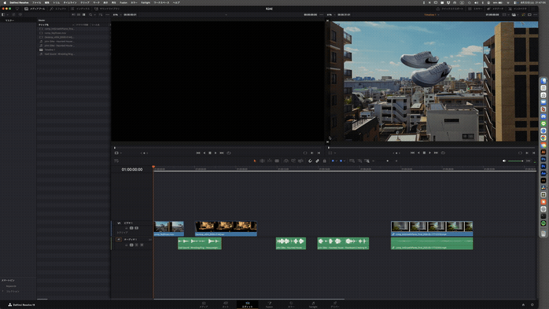

# R2AE

> 送受信の2ファイルをセットで更新してください。過去の修正と検証記録は [REVIEW.ja.md](REVIEW.ja.md) を参照してください。

**[English README](README.md)**

DaVinci Resolve のタイムラインから After Effects へ、クリップの配置・スケール・位置・回転・アンカーポイント・速度・音声を再現した状態で送るブリッジスクリプトです。

Adobe Dynamic Link のような常時リンクではありません。実行するたびに現在のタイムライン状態を JSON に書き出し、After Effects 側で新しいコンポジションとして再構築する「使い切りの転送」です。転送後は Resolve と After Effects の間に依存関係は残らず、どちらを編集しても相手に影響しません。

**本ツールは時短のための補助スクリプトであり、EDL や AAF、XML のような正確性を保証するデータ交換フォーマットではありません。** スケールや位置、アンカーポイントなどの変換式は、公式仕様に基づくものではなく、Resolveのインスペクタ値とAfter Effects上の実際の見え方を突き合わせた実測ベースで導出しています。手作業の繰り返しを省くために作られたものであり、両ソフト間の完全かつ無損失な橋渡しを保証するものではありません。重要な用途で使う場合は、必ず元のタイムラインと結果を見比べて確認してください。



## できること

- Editページのタイムラインで選択した映像・音声クリップだけを送信。WAVなどの音声クリップ単独でも送信可能
- 複数トラック（映像・音声）を対象。トラック単位 / クリップ単位の有効・無効を反映
- 現在のタイムライン固有の解像度・fps・DF/NDF表示・入力スケーリングと、転送範囲の開始タイムコードをコンポへ渡す
- クリップごとの Zoom・Pan/Tilt・Rotation・Anchor Point・Flip・Opacity を Scale / Position / Rotation / Anchor Point / Opacity に変換
- macOSでは、FCPXMLに含まれる位置・ズーム・回転・アンカーポイント・不透明度のキーを、AEで編集可能なキーフレームとして作成
- 速度変更を編集可能なタイムリマップとして転送。macOSでは、Resolveの「Nearest」を使った定速・直線区間の可変速で元コマを合わせる
- 一致する付随音声は動画レイヤーへ統合。それ以外のAトラックを独立音声レイヤーとして転送（チャンネル割当は未対応）。重複統合は任意設定
- 一致するAクリップがあるVレイヤーだけ音声ONにし、削除・無効化した音声の復活を防ぐ
- 同一転送内ではパス・素材解釈が一致する素材を再利用。転送をまたいだ再利用は行わず、既存コンプの素材解釈を保護

## できないこと

- リアルタイムの同期（Dynamic Link のような常時リンクではありません）
- トランジション、イーズ付きのスピードランプ、Fusionやエフェクトのキーフレーム
- カラーグレーディング、Resolve 側エフェクト、クロップ、複合クリップ、Fusion クリップ、タイトル
- ピッチ / ヨー（3D方向の傾き）は投影モデルの違いにより非対応

## 動作環境

- DaVinci Resolve 21.0.4以降（Resolve内のLuaスクリプトを使用）
- Adobe After Effects（2024 以降推奨）
- macOS または Windows

検証は macOS + DaVinci Resolve + After Effects 2026 の組み合わせで行っています。

**OSによってAEへの送信方式が異なります。**

- **macOS**: AppleScript経由でAEに直接スクリプト実行を指示します。常駐や追加設定は不要で、`r2ae`を実行するだけで自動的に完結します。
- **Windows**: 起動中のAfter Effectsプロセスを検出し、`AfterFX.exe -r`で直接スクリプトを実行させます。**あらかじめAfter Effectsを起動しておく必要があります**（未起動の場合は自動起動せず、その旨がResolveのコンソールに表示されます。JSONは書き出し済みなので、後からAEを起動して再実行すれば送れます）。複数バージョンのAEがインストールされている場合、実際に**起動しているバージョン**にクリップが送られます。

Windowsの今回の更新手順は [WINDOWS.ja.md](WINDOWS.ja.md) を参照してください。

## インストール

### 1. r2ae_receive.jsx の配置

```
macOS   : ~/Documents/ae_bridge/r2ae_receive.jsx
Windows : %USERPROFILE%\Documents\ae_bridge\r2ae_receive.jsx
```

`ae_bridge` フォルダが無ければ作成してください。

### 2. r2ae.lua の配置

```
macOS   : ~/Library/Application Support/Blackmagic Design/DaVinci Resolve/Fusion/Scripts/Utility/r2ae.lua
Windows : %APPDATA%\Blackmagic Design\DaVinci Resolve\Support\Fusion\Scripts\Utility\r2ae.lua
```

配置後、**DaVinci Resolve を完全に再起動**してください。スクリプトフォルダは起動時に一度だけ読み込まれます。

### 3. After Effects側の設定

環境設定 > スクリプトとエクスプレッション > 「スクリプトによるファイルへの書き込みとネットワークへのアクセスを許可」を ON にしてください。OFF のままだと JSON の読み込みでエラーになります。

### 4.（任意）r2ae_debug.lua

Resolve が返す値を確認したいときのための調査用スクリプトです。同じ Utility フォルダに置くとメニューに追加されます。動作に必須ではありません。

## 使い方

Windowsでは、先にAfter Effectsを起動してください。

1. ResolveのEditページで、タイムライン上の送りたい映像・音声クリップを選択する。
2. Workspace > Scripts > Utility > `r2ae` を実行する。After Effectsに新しいコンポが作成される。

コンポの開始タイムコードは、転送したクリップのうち最も早い位置です。クリップ間の空白、トラック順、編集済みのトリムを維持します。音声を送りたい場合は音声クリップも選択してください。選択が空の場合はコンポを作成しません。

Windowsで自動実行に失敗した場合は、AEのファイル > スクリプト > スクリプトファイルを実行から `r2ae_receive.jsx` を開くと、書き出し済みのJSONを取り込めます。

### ACES 2.0のIDTを引き継ぐ

リポジトリの `color` フォルダを、インストール先の `r2ae_receive.jsx` と同じ階層にコピーします。AE 26.5以降で、標準の **ACES 2.0 Studio v4.0** と Working Color Space の **ACES/ACEScg** を使用します。

macOSでResolveのACEScct 2.0からAEが未起動の状態で送ると、R2AEが32 bpc、Working Color Spaceが **ACES/ACEScg** の新規AEプロジェクトに取り込みます。**Display Color Space** にはResolveのODTに対応する設定を使います。対応先がない場合は `sRGB - Display / ACES 2.0 - SDR 100 nits (Rec.709)` になります。AEが起動中の場合は現在のプロジェクトのカラー設定を使います。

ResolveのAPIがACESバージョンを返さない場合、ACEScctのコールド起動は既定でACES 2.0として扱います。ACES 1.xと併用する場合は `ASSUME_ACES_2_ON_COLD_START` を `false` にできます。

ResolveのACES 2.0（ACESccまたはACEScct）から、クリップまたはプロジェクト既定のIDTを取得します。Sony、ARRI、Blackmagic、Canon、RED、ACEScct／ACEScg／ACES2065-1、および検証済みのRec.709／sRGB逆変換に対応します。正確な項目名は[ResolveとAEの色変換対応表](docs/IDT.ja.md)を参照してください。入力色空間は素材ごとに **フッテージを変換 > カラー** に保存されます。同梱のAEプロジェクトと参照クリップは転送時のプリセットに使用し、保存後のAEプロジェクトは元の素材を参照します。

ResolveのODTはコンポのコメントに記録します。プリセット適用時にピクセル縦横比などの素材属性を維持できない場合は、素材の元の解釈を保持し、IDTの手動設定が必要な項目として通知します。未対応のIDTも通知の対象です。

## 設定項目

`r2ae.lua` 冒頭の変数で挙動を変更できます。

| 変数 | 説明 |
|---|---|
| `AUDIO_MODE` | `"auto"`（既定。同素材・配置・トリム・速度の音声を動画レイヤーへ統合）/ `"separate"`（別レイヤー） |
| `DEDUPE_AUDIO` | `false`（既定）。`true` は同パス・同位置のAクリップを統合。L/R判定は行わないため音量やチャンネルが変わる可能性あり |
| `TIMELINE_FRAME_RATE_OVERRIDE` | 既定は `nil`。インターレースのAPI座標を実測した場合のみ、フレーム数/秒を指定 |
| `INPUT_SCALING` | `"auto"`（既定。タイムラインの「解像度が一致しないファイル」設定を使用）/ `"fit"` / `"fill"` / `"stretch"` / `"none"` |
| `ROTATION_SIGN` | `1` / `-1`（既定）— 回転方向の補正 |
| `SOURCE_ROTATION_BY_PATH` | 既定は空。絶対パスと追加回転角（時計回り `90`、反時計回り `-90`、半回転 `180`、補正なし `0`）を指定すると自動補正より優先 |
| `ENABLE_SPEED` | `true`（既定）— 速度変更をタイムリマップに反映するか |
| `ENABLE_TRANSFORM_KEYFRAMES` | `true`（既定）— macOSで編集ページのTransformキーフレームを転送するか |
| `RESPECT_TRACK_ENABLE` | `true`（既定）— 無効化したトラックを除外するか |
| `RESPECT_CLIP_ENABLE` | `true`（既定）— 無効化したクリップ（`D`キー）を除外するか |

## 仕組み

1. `r2ae.lua` が Resolve Scripting API 経由でタイムラインを読み、対象クリップのパス・トリム位置・Transform 値・速度をまとめて JSON に書き出す
2. **macOS**: `osascript` で After Effects に `r2ae_receive.jsx` の実行を直接指示する
3. **Windows**: `Get-Process` で起動中の`AfterFX.exe`の実パスを取得し、`AfterFX.exe -r`で`r2ae_receive.jsx`の実行を直接指示する（After Effectsが起動している必要がある。うまくいかない場合は手動実行で後から取り込める）
4. `r2ae_receive.jsx` が JSON を読み込み、素材をインポートしてコンポジションを構築する

以降、両ソフト間の接続は残りません。

## Transform 変換について

Resolve のインスペクタ値（Zoom / Pan / Tilt / Anchor Point / Rotation）は、タイムライン解像度・素材解像度・プロジェクトのスケーリング設定が絡み合った座標系を持っています。特に Anchor Point は単純な位置ではなく「ピボット」として扱われており、値を動かすと画面上の表示位置も一緒に動きます。このツールでは実測に基づいてこの変換式を導出しています（詳しくは `r2ae.lua` 内のコメントを参照）。

映像レイヤーは開始が早いものからAEの下から上へ並びます。時間が重なる区間はResolveの上位映像トラックをAEでも上に置きます。

元のフッテージをメインコンプのレイヤーに直接配置します。入力スケーリングと向き補正を、Resolveのインスペクタの変形と合わせてレイヤーのTransformに反映します。

macOSのResolve 21.2では、タイムラインの一時DRT書き出しからクリップ属性の「Image Orientation」を読み取り、素材に埋め込まれた向きとの差だけを適用します。手動で上書きする場合や、他のバージョンで回転補正が必要な場合は `SOURCE_ROTATION_BY_PATH` を使えます。

macOSでは、Resolveが書き出した一時FCPXMLから選択クリップのキーフレームを抽出します。AEでの補間は直線です。FCPXMLに含まれるキーはトリムの前後も元の相対時刻に配置し、レイヤーの表示範囲はResolveのトリムに合わせます。同じ素材が同じ位置・尺で重なって区別できない場合や、FCPXMLでリタイムが付いているクリップは静的なTransformで送ります。

## fps・DF・インターレース

動画は素材のfpsを維持します。Resolveの素材fpsとカメラfpsが同じ1000/1001系で、AEが整数fpsとして読み込んだ場合は、素材解釈をカメラfpsに合わせます。画像連番にはResolveの素材fpsを設定します。Resolveがクリップ速度を返す場合はその値を優先します。可変フレームレート素材などでResolveとAEが異なるフレーム数を報告しても、実時間の尺が約1フレーム以内で一致する場合は秒基準で配置します。素材解釈fpsそのものが異なる場合は、Time Remapで差を補正します。

macOSでは、プログレッシブ素材をプログレッシブなタイムラインでリタイムし、リタイム処理が「Nearest」の場合に、FCPXMLの速度マップとResolveのトリム情報から元コマを合わせます。定速の早送り・スロー、逆再生、フリーズ、FCPXMLで直線区間として取得できる可変速が対象です。AEでは元素材のレイヤーに編集可能なタイムリマップキーを作成します。コマ合わせを適用するクリップの選択済み音声は別レイヤーになります。可変速の音声は定速で転送します。

素材とタイムラインのfpsが異なるリタイムでは、Resolve 21.2の一時DRTから内部の速度点・トリム・素材解釈fpsを取得し、AEでは元素材のfpsを保ったまま参照コマを指定します。DRTから時刻情報を取得できない場合は、FCPXMLの値で近似し、転送時に通知します。

DFはタイムコードの番号付けであり、フレームの削除や速度変更ではありません。コンポのDF/NDFは明示設定します。元動画は再エンコード・変更せず読み込み、素材のタイムコードはAEのインポータに委ねます。Resolveの素材Start TC/FPS文字列はコメントへ記録しますが、素材DF表示やResolveで変更したStart TCの完全な再設定を保証しません。

Resolveが返す素材の実際の `Field Dominance` をAEのフィールド分離へ反映します。`Progressive`、`Upper Field`、`Lower Field` などに対応し、順序が不明な場合はAEの自動解釈を使って通知します。AEのフィールド出力はレンダー設定で指定します。

インターレース設定は `timelineInterlaceProcessing` から取得します。有効かつAPIレートが49以上のタイムラインでは、コンポfps・配置・尺・開始フレームを1/2に換算します。1080i59.94は29.97fps、50iは25fpsになります。プログレッシブ59.94fpsは元のレートを維持します。macOSの実機検証では、1080i59.94 DFの10分尺がAEで17,982フレームになり、12本のプログレッシブ素材の境界と素材INが一致しました。上位・下位フィールドの素材では、AEのフィールド分離設定と時系列のサンプルを確認しました。

## 既知の制約

- Frame Blend、Optical Flow、Speed Warp、イーズ付き可変速、インターレース素材・タイムラインのリタイム、VFR素材はコマが一致しない場合があります。速度マップを適用できない場合は定速で転送し、ResolveのAPIが速度を返さない場合は素材とタイムラインのフレーム範囲から推定します。Windowsは定速の転送に対応しています
- ピッチ / ヨーは Resolve と After Effects で投影モデルが異なるため、正確な再現ができず非対応としています
- 音量・パン・モノ/ステレオのチャンネル割当・Fairlight FX・ピッチ維持・サンプル単位の音声IN点は保証しません。L/R分割素材はAEで確認してください
- 非正方形ピクセルを含むTransformやカラー管理の完全一致は保証しません
- Windowsの自動実行には、あらかじめAfter Effectsが起動している必要があります。未起動の場合は自動起動せず、コンソールにその旨が表示されます（JSONは書き出し済みなので、後からAEを起動して手動実行で取り込めます）

## ライセンス

MIT License. `LICENSE` を参照してください。

## 免責事項

本ツールは DaVinci Resolve および After Effects の公式ドキュメント記載のスクリプティング API のみを使用しています。両ソフトの内部実装や非公開 API には依存していませんが、将来のバージョンアップで API の挙動が変わった場合、動作しなくなる可能性があります。無保証で提供されます。重要なプロジェクトで使用する前に、必ずテスト環境で動作を確認してください。
