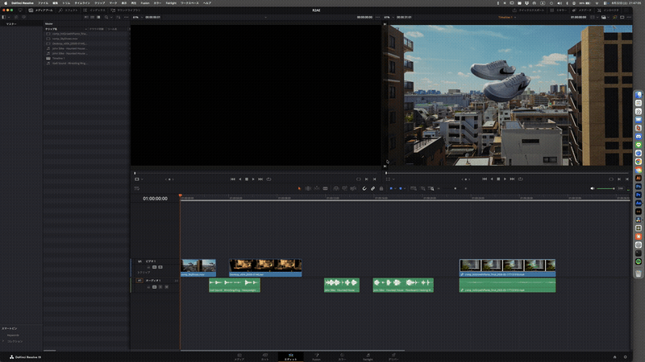

# R2AE

> Update both scripts together. See [REVIEW.ja.md](REVIEW.ja.md) for earlier fixes and verification results.

**[日本語 README](README.ja.md)**

A bridge script that sends clips from a DaVinci Resolve timeline to After Effects, reproducing their placement, scale, position, rotation, anchor point, speed, and audio.

This is not a persistent link like Adobe Dynamic Link. Each time you run it, the script writes out the current timeline state as JSON and After Effects rebuilds it as a new composition — a one-shot transfer. After the transfer, there is no ongoing dependency between Resolve and After Effects; editing either one has no effect on the other.

**This is a convenience script, not a data interchange format.** Unlike EDL, AAF, or XML, it makes no accuracy guarantees. The transform math (scale, position, anchor point, etc.) was derived empirically by comparing Resolve's inspector values against After Effects' rendered output, not from official specifications. It's built to save time on a repetitive manual task, not to be a certified, lossless bridge between the two applications. Always check the result against the original timeline before relying on it.



## What it does

- Sends selected clips from the Edit page timeline, including standalone audio such as WAV clips
- Supports multiple tracks (video and audio). Respects track-level and clip-level enable/disable
- Transfers the current timeline's resolution, fps, DF/NDF display, input sizing and the start timecode of the transferred span
- Converts each clip's Zoom, Pan/Tilt, Rotation, Anchor Point, Flip, and Opacity into AE's Scale / Position / Rotation / Anchor Point / Opacity
- On macOS, rebuilds exported position, zoom, rotation, anchor point, and opacity keys as editable After Effects keyframes
- Uses editable AE Time Remap keys for speed changes. On macOS it can match source frames for Resolve Nearest retimes, including supported linear variable-speed segments.
- Merges matching audio into video layers and keeps other audio on separate layers. Channel mapping is unsupported.
- Prevents double playback of audio linked to a video clip
- Reuses matching footage within a transfer; subsequent transfers import fresh footage to isolate interpretation settings

## What it doesn't do

- Real-time sync (this is not a persistent link like Dynamic Link)
- Transitions, eased speed ramps, and keyframes for Fusion or effects
- Color grading, Resolve-side effects, cropping, compound clips, Fusion clips, titles
- Pitch / Yaw (3D tilt) — not supported due to differences in projection models between the two applications

## Requirements

- DaVinci Resolve 21.0.4 or later with in-app Lua scripting
- Adobe After Effects (2024 or later recommended)
- macOS or Windows

Testing has been done on macOS with DaVinci Resolve and After Effects 2026.

**The delivery mechanism to After Effects differs by OS.**

- **macOS**: Uses AppleScript to tell After Effects to run the script directly. No setup beyond installing the two files is needed — running `r2ae` is enough.
- **Windows**: Detects the running After Effects process and calls `AfterFX.exe -r` to run the script directly against it. **After Effects needs to already be running** — if it isn't, R2AE doesn't launch it automatically; the Resolve console says so, and the JSON is left written for you to pick up once you've opened After Effects and run `r2ae` again. If multiple AE versions are installed, the clips go to whichever version is currently running.

Windows update instructions: [WINDOWS.ja.md](WINDOWS.ja.md) (Japanese).

## Installation

### 1. Place r2ae_receive.jsx

```
macOS   : ~/Documents/ae_bridge/r2ae_receive.jsx
Windows : %USERPROFILE%\Documents\ae_bridge\r2ae_receive.jsx
```

Create the `ae_bridge` folder if it doesn't exist.

### 2. Place r2ae.lua

```
macOS   : ~/Library/Application Support/Blackmagic Design/DaVinci Resolve/Fusion/Scripts/Utility/r2ae.lua
Windows : %APPDATA%\Blackmagic Design\DaVinci Resolve\Support\Fusion\Scripts\Utility\r2ae.lua
```

After placing it, **fully restart DaVinci Resolve**. The scripts folder is only scanned once, at startup.

### 3. After Effects settings

In Preferences > Scripting & Expressions, enable "Allow Scripts to Write Files and Access Network". If left off, loading the JSON will fail with an error.

### 4. (Optional) r2ae_debug.lua

A diagnostic script for inspecting the raw values Resolve returns. Place it in the same Utility folder to add it to the menu. Not required for normal operation.

## Usage

On Windows, open After Effects first.

1. In the Resolve Edit page, select the video and audio clips you want to send from the timeline.
2. Run Workspace > Scripts > Utility > `r2ae` to create a new composition in After Effects.

The composition starts at the earliest transferred clip's timecode and preserves edits, gaps, and track order. Select the audio clips you want to include. An empty selection produces no composition.

If Windows automation fails, open `r2ae_receive.jsx` via File > Scripts > Run Script File in After Effects to import the exported JSON.

### ACES 2.0 input transforms

For IDT transfer, copy the repository's `color` folder next to the installed receiver. Use After Effects 26.5 or later with its built-in **ACES 2.0 Studio v4.0** configuration and **ACES/ACEScg** as Working Color Space.

On macOS, sending from ACEScct 2.0 while AE is closed launches AE and imports into a new 32 bpc project with **ACES/ACEScg** as Working Color Space. R2AE sets the project's **Display Color Space** to a verified equivalent of the Resolve ODT. Unmapped values use `sRGB - Display / ACES 2.0 - SDR 100 nits (Rec.709)`. Transfers to an already running AE use its current project color settings.

If Resolve does not report its ACES version, R2AE defaults to ACES 2.0 for ACEScct cold starts. Set `ASSUME_ACES_2_ON_COLD_START` to `false` if you also work in ACES 1.x.

R2AE reads the Resolve clip or project IDT in an ACES 2.0 project (ACEScc or ACEScct). Supported transforms include Sony, ARRI, Blackmagic, Canon, RED, ACEScct, ACEScg, ACES2065-1, and verified inverse display transforms for Rec.709 and sRGB. See the [Resolve–AE color transform table (Japanese)](docs/IDT.ja.md) for exact names. The input override is saved with each footage item in **Interpret Footage > Color**. The bundled AE project and reference clip supply the input presets during transfer. Saved projects link directly to the original media.

R2AE records the Resolve ODT in the comp comment for reference. If a preset would change source attributes such as pixel aspect, R2AE keeps the source's native interpretation and reports the clip for manual IDT assignment. Unsupported inputs are also reported.

## Configuration

Behavior can be changed via variables at the top of `r2ae.lua`.

| Variable | Description |
|---|---|
| `AUDIO_MODE` | `"auto"` (default; merges matching A/V items) / `"separate"` (independent audio layers) |
| `INPUT_SCALING` | `"auto"` (default; uses the timeline's input sizing setting) / `"fit"` / `"fill"` / `"stretch"` / `"none"` |
| `ROTATION_SIGN` | `1` / `-1` (default) — corrects rotation direction |
| `SOURCE_ROTATION_BY_PATH` | Optional override of automatic source orientation. Map an absolute path to a clockwise adjustment of `90`, `-90`, `180`, or `0` degrees from AE's imported orientation. |
| `ENABLE_SPEED` | `true` (default) — whether speed changes are reflected as Time Remap |
| `ENABLE_TRANSFORM_KEYFRAMES` | `true` (default) — transfer Edit page transform keys on macOS |
| `RESPECT_TRACK_ENABLE` | `true` (default) — exclude disabled tracks |
| `RESPECT_CLIP_ENABLE` | `true` (default) — exclude disabled clips (the `D` key state) |

## How it works

1. `r2ae.lua` reads the timeline via the Resolve Scripting API and writes each target clip's file path, trim points, transform values, and speed to a JSON file
2. **macOS**: `osascript` tells After Effects to run `r2ae_receive.jsx` directly
3. **Windows**: finds the running `AfterFX.exe` process via `Get-Process` and calls `AfterFX.exe -r` to run `r2ae_receive.jsx` directly (After Effects must already be running; if this doesn't work in your environment, manual execution can pick up the JSON instead)
4. `r2ae_receive.jsx` reads the JSON, imports the footage, and builds the composition

After that, there is no remaining connection between the two applications.

## About the transform conversion

Resolve's inspector values (Zoom / Pan / Tilt / Anchor Point / Rotation) live in a coordinate system shaped by the timeline resolution, the source resolution, and the project's input scaling setting. In particular, Anchor Point in Resolve behaves as a pivot rather than a simple offset — moving it also moves the clip's on-screen position. This tool derives the conversion formulas from measured, real-world values (see the comments in `r2ae.lua` for details).

On macOS, R2AE extracts keys for the selected clips from a temporary Resolve FCPXML export. AE uses linear interpolation and preserves the exported key times, including keys outside the layer's visible in/out points. Clips with a time map and overlapping instances of the same media with identical placement and duration transfer with static transforms.

## Timing and interpretation in this revision

Image sequences use their Resolve source fps. For movies, when Resolve's clip fps matches the camera's fractional 1000/1001 rate and AE imports at the corresponding whole fps, R2AE sets the footage interpretation to the camera rate. R2AE uses the clip speed reported by Resolve when available. When Resolve and AE report different source frame counts but agree on the elapsed duration within about one frame, R2AE places the clip by elapsed time. Frame-rate reinterpretation still uses Time Remap. DF is timecode numbering, not frame removal. Composition DF is explicitly set; source DF and Resolve-only source timecode overrides are not guaranteed. Source timecode and FPS metadata are recorded in comments.

For progressive footage on a progressive timeline, macOS uses the Resolve FCPXML time map and precise trim data to match individual source frames when the retime process is Nearest. This covers constant speed, reverse, freeze, and variable speeds represented by linear time-map segments. The original footage remains on the layer and the Time Remap keys are editable. R2AE keeps selected audio for these clips on a separate layer so frame matching does not change its playback cadence. Variable-speed audio still transfers using a constant rate.

For retimed clips whose source fps differs from the timeline fps, Resolve 21.2's DRT export supplies the original time-map points, trim, and effective source rate. R2AE uses those values to choose source frames with the original footage interpretation in AE. If DRT timing is unavailable, R2AE reports that it is using the FCPXML approximation.

Video layers run bottom to top in start-time order where possible. Overlaps retain Resolve's video track priority. R2AE adds the original footage directly to the main composition. The layer Transform combines input scaling and source orientation with the Resolve Inspector transforms.

On macOS with Resolve 21.2, R2AE reads Clip Attributes > Image Orientation from a temporary DRT timeline export. It applies the difference from the source file's embedded orientation. `SOURCE_ROTATION_BY_PATH` is available for manual overrides and other Resolve versions.

R2AE uses Resolve's effective source Field Dominance to set AE field separation. Unknown values retain the importer's interpretation and produce a notice. Field rendering is set separately in AE's render settings. When `timelineInterlaceProcessing` is on and the API rate is at least 49, R2AE divides the timeline tick rate and positions by two to express them in full frames. Progressive 59.94 fps retains its frame rate. A macOS test of 1080i59.94 DF verified 17,982 frames, the timecode span and all 12 progressive edits in AE. Separate tests checked the field order and temporal samples of upper- and lower-field-first footage.

In auto mode, matching source, timing, trim and speed allow one A item to enable embedded audio on one video layer. Unmatched audio stays separate and video without a matching A item stays muted. `DEDUPE_AUDIO` defaults to false. Channel mapping, volume, pan, Fairlight processing, pitch preservation and sample-accurate audio trims are unsupported.

## Known limitations

- Frame Blend, Optical Flow, Speed Warp, eased retime curves, interlaced retimes, and VFR footage can differ between applications. If a frame map cannot be used, R2AE falls back to a constant rate. When Resolve does not report a speed, the rate is estimated from the source and timeline frame ranges. Windows uses the constant-speed path.
- Pitch / Yaw are not supported, since Resolve and After Effects use different projection models and cannot be reconciled accurately
- Windows automatic execution requires After Effects to already be running. If it isn't, R2AE doesn't launch it automatically — the Console will say so, and the JSON stays written so you can pick it up later (open After Effects, then run the script manually)

## License

MIT License. See `LICENSE`.

## Disclaimer

This tool only uses the officially documented scripting APIs of DaVinci Resolve and After Effects. It does not rely on either application's internal implementation or any undocumented API, but future versions of either application may change API behavior in ways that break this tool. Provided with no warranty. Please verify behavior in a test environment before relying on this for important projects.
